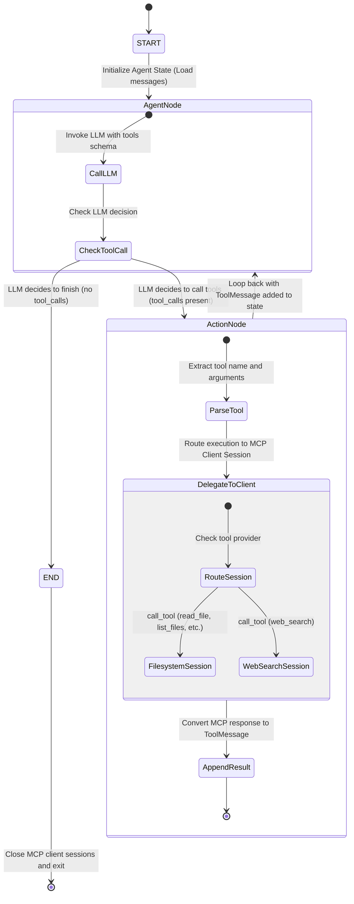
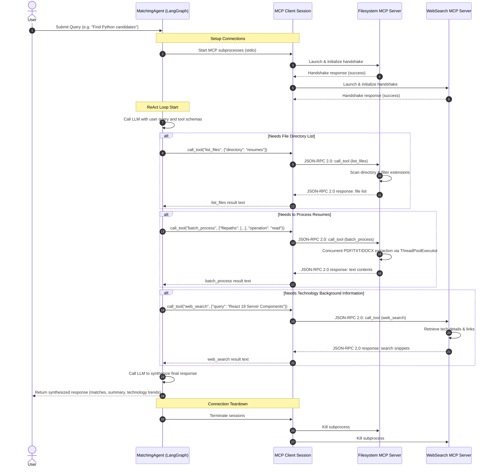

# State Machine & Workflow Diagram (Agent ↔ MCP Interaction)

This document describes the state machine flow and communication sequence between the LangGraph matching agent, the MCP client, and the multiple MCP servers (Filesystem MCP Server and Web Search MCP Server).

---

## 1. LangGraph Agent State Machine Diagram

Below is the state transition diagram of the ReAct agent built with LangGraph. When a user sends a query, the agent iterates by calling tools through the MCP client and processing the results until the task is complete.

---

## 2. Communication Sequence Diagram

Below is the sequence diagram illustrating how JSON-RPC 2.0 communication flows over stdio between the Agent, the MCP Client, and the independent MCP Server subprocesses.

